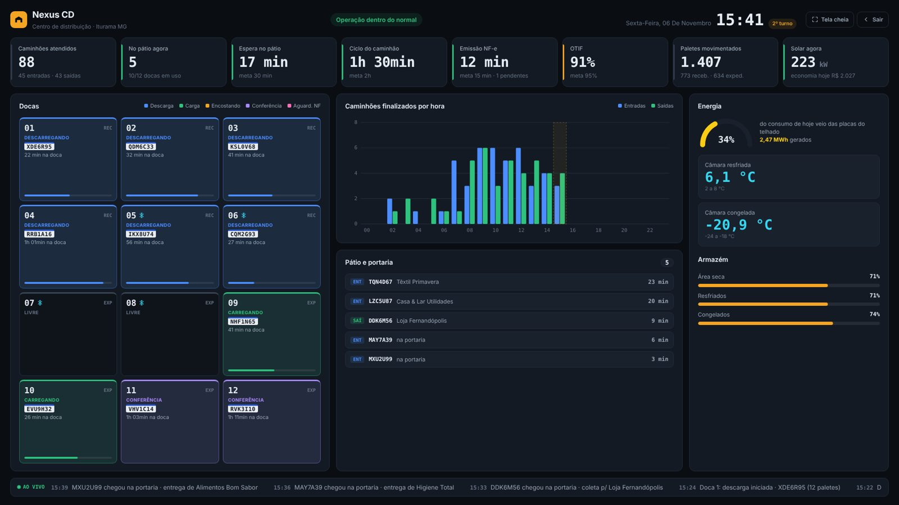
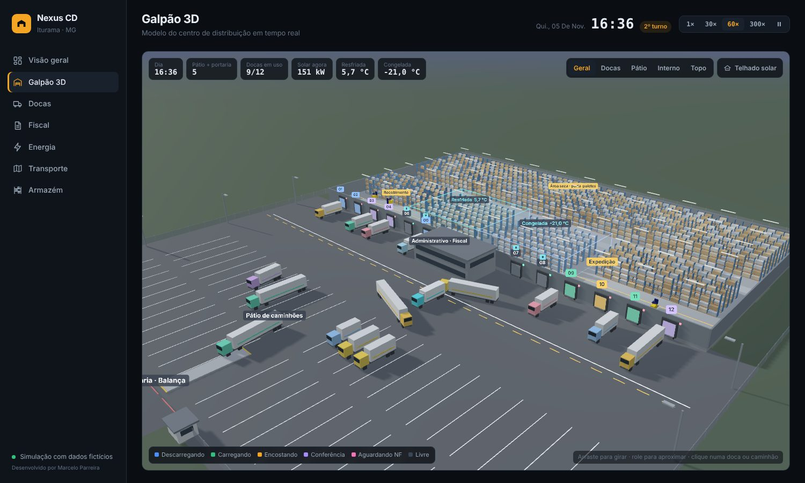
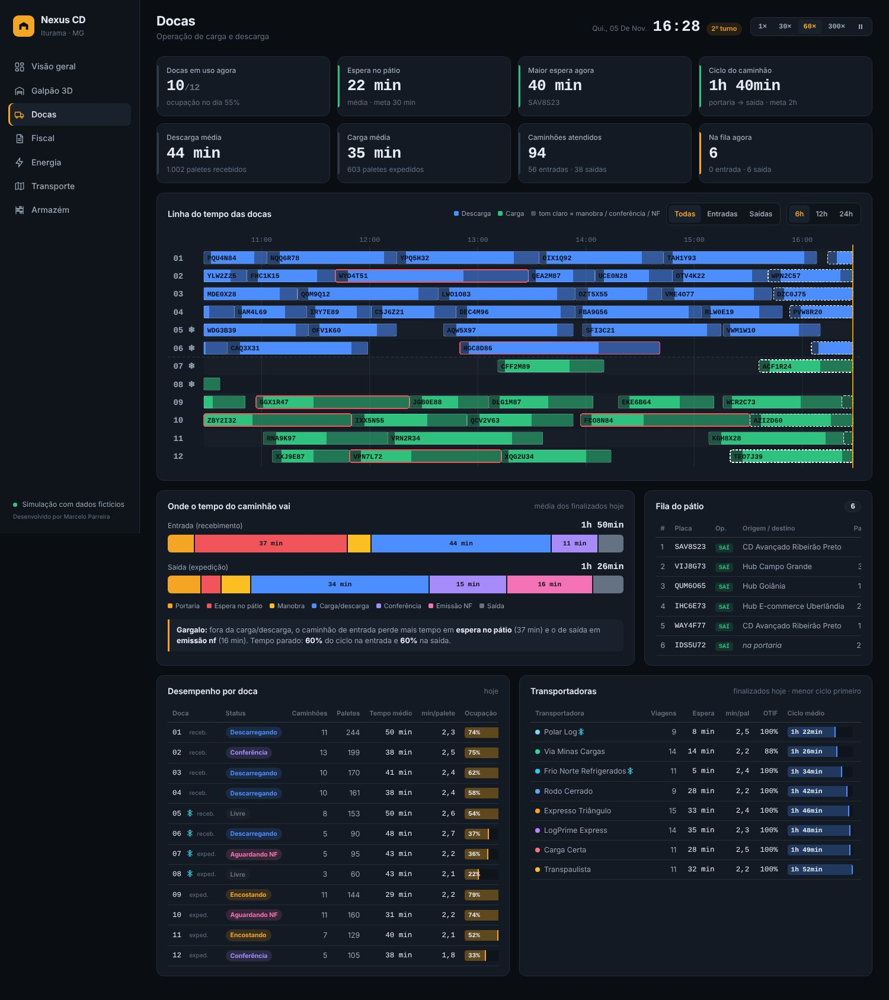

# Nexus CD · Painel de Centro de Distribuição

Painel de operação de um centro de distribuição de **e-commerce e varejo**, com galpão em **3D**, docas, fiscal, energia solar, transporte e armazém, tudo funcionando **ao vivo** a partir de uma simulação.

> Projeto de portfólio. Empresas, transportadoras, motoristas e números são **fictícios**. As cidades e distâncias são reais (região do Triângulo Mineiro, interior de SP, GO e MS).

**[▶ Abrir o painel](https://jmarcelogomesparreira.github.io/centro-distribuicao-3d/)**



---

## O que tem no painel

| Tela | Destaques |
|---|---|
| **Visão geral** | KPIs com meta, 12 docas em tempo real, fila do pátio, caminhões por hora, energia, câmaras frias, feed de eventos |
| **Galpão 3D** | Prédio de 160 × 80 m, caminhões entrando, manobrando até a doca e saindo, empilhadeiras, porta-paletes que enchem e esvaziam, câmaras frias, telhado com placas solares, ciclo de dia e noite, clique na doca ou no caminhão para ver o detalhe |
| **Docas** | Linha do tempo (Gantt) por doca, ciclo do caminhão dividido por etapa, identificação automática do gargalo, desempenho por doca e por transportadora |
| **Fiscal** | Tempo de lançamento da NF de entrada e de emissão da NF-e de saída, SLA, fila do fiscal, divergências com motivo, CFOP |
| **Energia** | Geração solar x consumo hora a hora, balanço com a rede, consumo por área, inversores, iluminação por zona |
| **Transporte** | Mapa com as rotas e caminhões em trânsito, previsão de chegada, OTIF, custo de frete por km e por palete, motoristas |
| **Armazém** | Mapa de ocupação por rua, histórico de temperatura das câmaras, curva ABC, validade (FEFO), inventário rotativo, segurança do trabalho (NBR 14280, NR-11, pausa térmica do art. 253 da CLT) |
| **Modo TV** | Resumo em uma tela 16:9 para televisão do setor, com alertas automáticos |





## Como a simulação funciona

O painel abre no **horário real** e simula o dia desde 00:00. A partir daí, cada caminhão passa pelas mesmas etapas de um CD de verdade:

```
Portaria → Pátio → Manobra → Carga/descarga → Conferência → NF → Saída
```

- As chegadas variam conforme a hora do dia (pico de recebimento de manhã e de expedição à tarde).
- Cada doca só recebe o tipo certo de caminhão (entrada/saída, seco/refrigerado).
- Na expedição, o caminhão só sai da doca depois que o fiscal emite a NF-e. Quando a fila do fiscal cresce, a emissão demora mais.
- O estoque sobe com as entradas e desce com as saídas, e o 3D acompanha.
- A geração solar segue a posição do sol e a nebulosidade, e o consumo segue o turno.
- O controle de velocidade (1×, 30×, 60×, 300×) acelera o dia para ver a operação inteira em poucos minutos.

## Tecnologias

- HTML, CSS e JavaScript puro, **sem framework e sem build**
- [Three.js](https://threejs.org/) para o galpão 3D
- [Leaflet](https://leafletjs.com/) + CARTO/OpenStreetMap para o mapa de rotas
- Gráficos desenhados em SVG, feitos à mão
- Hospedagem no GitHub Pages

## Estrutura

```
index.html       esqueleto, menu e cabeçalho
estilo.css       visual (tema escuro, responsivo)
dados.js         cadastros: docas, transportadoras, fornecedores, destinos, cidades
simulador.js     motor da operação ao vivo e cálculo dos KPIs
graficos.js      gráficos SVG reaproveitáveis
geral.js         tela Visão geral
cena3d.js        galpão 3D
docas.js         tela Docas
fiscal.js        tela Fiscal
energia.js       tela Energia
transporte.js    tela Transporte
armazem.js       tela Armazém
tv.js            Modo TV
app.js           navegação, relógio e velocidade
```

## Rodar no computador

Baixe a pasta e abra o `index.html` no navegador. Não precisa instalar nada. O 3D e o mapa carregam bibliotecas da internet, e o resto funciona offline.

---

Desenvolvido por **Marcelo José Gomes Parreira** · [LinkedIn](https://www.linkedin.com/in/marcelo-jos%C3%A9-gomes-parreira-101b352ab) · [GitHub](https://github.com/jmarcelogomesparreira)
